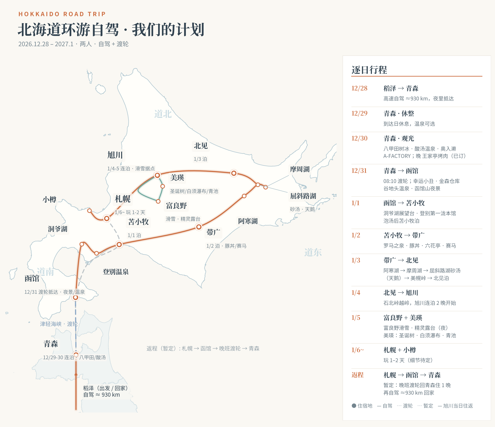

# 2026.12.28 – 2027.01.10 北海道自驾行程（青森・函館・1/1・1/2・1/3北見・1/4旭川（動物園）・1/5〜6富良野スキー・1/6夜札幌まで計画 / 札幌以降・帰路は未定）

自宅（愛知県稲沢市）→ 高速夜行 → 青森（2泊）→ フェリー → 函館（12/31泊）→ 洞爺湖・登別 → 苫小牧（1/1泊）→ 帯広（1/2泊）→ 阿寒・摩周・屈斜路 → 北見（1/3泊）→ 旭川（1/4・1/5泊）→ 富良野スキー（1/5・1/6）→ 1/6 夜 札幌（泊）→ 札幌・小樽（詳細は後日）
同行：2名 / 車：日産ノート（スタッドレス装着）/ 移動は全て自家用車（自驾）

### 住宿计划

| 日期 | 住宿 | 支付 | 预计入住时间 | 餐食 | 停车 |
| --- | --- | --- | --- | --- | --- |
| 12.29(Tue) | **[アルファホテル青森](https://www.google.com/maps/search/?api=1&query=アルファホテル青森)**（青森市橋本1-1-7 / TEL 017-773-3000） | **¥7,650 已付**（オンラインカード決済） プラン価格¥8,500－即時利用¥850 Yahoo!トラベル 予約番号：IY1736620890 | 15:00～（チェックイン可能 15:00〜29:00） | **朝食付** | **駐車料金込プラン**（駐車費込み） |
| 12.30(Wed) | **[アルファホテル青森](https://www.google.com/maps/search/?api=1&query=アルファホテル青森)**（同上・連泊だが1泊ごとの別予約） | **¥7,650 已付**（オンラインカード決済） Yahoo!トラベル 予約番号：IY1736571666 | —（チェックアウト 11:00、翌朝そのまま継続） | **朝食付** | **駐車料金込プラン** |
| 12.31(Thu) | **[スマイルホテルプレミアム函館五稜郭](https://www.google.com/maps/search/?api=1&query=スマイルホテルプレミアム函館五稜郭)**（函館市本町8-15） | **¥8,948 已付**（Hotels.com、11/5支払済） Itinerary # 73581505071627 12/30 23:59までキャンセル無料 | 15:00～（チェックアウト 1/1 11:00） | **朝食ビュッフェ付** | **¥800/泊**（自社立体駐車場14台・先着順、予約不可） |
| 1.1(Fri) | **[koko hotel 苫小牧](https://www.google.com/maps/search/?api=1&query=koko+hotel+苫小牧)**（苫小牧市表町5-7-1 / TEL 0144-33-0333） | **¥10,372**（Trip.com 前払い、12/29にVISAデビット(1059)へ請求予定） 予約番号：1688902512550589 12/30 23:59までキャンセル無料 | 15:00～（チェックアウト 1/2 11:00） | **朝食付**（1/2 朝食 2名分） | **¥300/泊**（提携・苫小牧駅前立体駐車場 300台、高さ2.1mまで） |
| 1.2(Sat) | **[リッチモンドホテル帯広駅前](https://www.google.com/maps/search/?api=1&query=リッチモンドホテル帯広駅前)**（Richmond Hotel Obihiro Ekimae、帯広市西2条南11-17 / TEL 0155-20-2255） | **¥10,869**（Booking.com、カード自動請求・未払い） 確認番号：6902627904 12/31 23:59までキャンセル無料（1/1以降の取消料 ¥12,200） | チェックイン 14:00～（チェックアウト 1/3 11:00） | **朝食付** | **¥800/泊**（立体駐車場40台・先着順、予約不可。2026/4/20に¥600→¥800へ改定済み） |
| 1.3(Sun) | **[コンフォートホテル北見](https://www.google.com/maps/search/?api=1&query=コンフォートホテル北見)**（Comfort Hotel Kitami、北見市大通西3丁目4 / TEL 0157-32-8411） | **¥4,950**（Yahoo!トラベル、オンラインカード決済） 予約番号：IN1737496456 2日前までキャンセル無料（前日20%・当日80%）／宿泊税 1人1泊 ¥300～700 別途 | チェックイン 15:00～24:00（チェックアウト 1/4 10:00） | **朝食付** | **無料**（敷地内31台・先着順、予約不可） |
| 1.4(Mon) | **[くれたけイン旭川](https://www.google.com/maps/search/?api=1&query=くれたけイン旭川)**（旭川市4条通9丁目1704-18 / TEL 0166-27-9111） | **2泊合計 ¥17,640 已付**（オンラインカード決済・前金） プラン料金¥19,600－即時利用¥1,960 Yahoo!トラベル 予約番号：IN1737881122 2日前までキャンセル無料（前日20%・当日80%・不泊100%） | チェックイン 15:00～24:00（チェックアウト 1/6 10:00） | **朝食付**（無料朝食バイキング） | **¥800/泊**（立体28台＋平面4台・先着順、予約不可） |
| 1.5(Tue) | **[くれたけイン旭川](https://www.google.com/maps/search/?api=1&query=くれたけイン旭川)**（連泊・同上） | （1/4の予約に含む） | — | **朝食付** | **¥800/泊**（同上） |
| 1.6(Wed) | **札幌（ホテル未定・要予約）**（1/6 は富良野スキー後に夜着、1/7 以降も札幌泊の想定） | 未予約 | 夜 19:30〜20:00 着想定 | — | 駐車場つきで選ぶ |

- [アルファホテル青森](https://www.google.com/maps/search/?api=1&query=アルファホテル青森)
    - 部屋：禁煙ワイドシングル(ダブル) ×1室、大人2名
    - 場所：JR青森駅から徒歩20分・車で5分
- [スマイルホテルプレミアム函館五稜郭](https://www.google.com/maps/search/?api=1&query=スマイルホテルプレミアム函館五稜郭)
    - 部屋：スタンダードダブル、大人2名
    - 場所：五稜郭エリア（函館駅前ではなく本町）
    - 駐車場：自社立体駐車場 14台、**¥800/泊**（15:00～翌11:00）、先着順・予約不可。車両制限：全長5.3m・全幅2.05m・全高2.05m（ノートは余裕で可）。満車時は隣の提携ロマーナパーキング（98台、同¥800、出し入れ不可）か近隣コインパーキング
- [koko hotel 苫小牧](https://www.google.com/maps/search/?api=1&query=koko+hotel+苫小牧)
    - 部屋：ダブルルーム（禁煙）クイーンベッド1台、大人2名
    - 備考：宿泊税は到着時に別途支払い
    - 駐車場：ホテル内に駐車場なし。提携の**苫小牧駅前立体駐車場**（300台）が **¥300/泊**、高さ制限 2.1m（ノートは可）。高さ 2.1m 超の車は敷地内駐車場 ¥1,100/泊
- [リッチモンドホテル帯広駅前](https://www.google.com/maps/search/?api=1&query=リッチモンドホテル帯広駅前)
    - 部屋：ダブルルーム（禁煙）、大人2名
    - 駐車場：立体駐車場 40台＋提携（青空）、**¥800/泊**（2026/4/20 改定後の料金。予約時に ¥600 表示でも現地は ¥800）。先着順・予約不可、満車時は提携駐車場も同額。車両制限：全長5.0m・全幅1.8m・全高2.0m（ノートは可）
- [コンフォートホテル北見](https://www.google.com/maps/search/?api=1&query=コンフォートホテル北見)
    - 部屋：ダブルエコノミー（禁煙）×1室、大人2名、朝食付
    - 場所：北見市大通西3丁目4（JR北見駅 徒歩約3分）／ TEL 0157-32-8411
    - 駐車場：敷地内 31台 **無料**（1室1台、15:00～翌10:00、先着順・予約不可）
- [くれたけイン旭川](https://www.google.com/maps/search/?api=1&query=くれたけイン旭川)
    - 部屋：ダブル【喫煙】15㎡（ベッド幅180cm）×1室、大人2名、朝食付（無料朝食バイキング 6:30～9:30、ハッピーアワードリンク1杯付きプラン）
    - 場所：旭川市4条通9丁目1704-18（JR旭川駅 徒歩8分）／ TEL 0166-27-9111
    - 駐車場：立体28台＋屋外平面4台、**¥800/泊**（15:00～翌10:00、車種により ¥1,000〜2,000 に変動あり、先着順・予約不可、車高2.0mまで → ノートは可）。満車時は近隣駐車場を自分で探す運用
- 合計：青森2泊＋函館1泊 **¥24,248**（全て支払済）。苫小牧 ¥10,372（12/29 請求）・帯広 ¥10,869（未払い）・北見 ¥4,950（カード決済）・旭川2泊 ¥17,640（カード決済・支払済）は下の費用表に反映

### 行程计划

#### 12月28日(Mon)　出発日

- 出発：中午、自宅（稲沢市）
- 移動：自家用車、全程高速で北上（夜行）— 自宅（稲沢）→ アルファホテル青森：**約927km・約11時間30分**（Google マップ実測 2026/11/6。東海北陸道 → 北陸道 → 日本海東北道 → 東北道 経由、休憩時間は別）
- 到着：12/29 凌晨 ～ 午前12:00前、青森
- 備考：サービスエリアで仮眠しながら走行

#### 12月29日(Tue)　青森到着日（休息日）

1. 温泉（オプション）
    - 位置づけ：**必ず行く予定ではない**。時間と体力に余裕があれば行く、なければ省略してOK
    - 備考：省略する場合は市内で昼ごはん → そのままホテルへ向かう
2. [アルファホテル青森](https://www.google.com/maps/search/?api=1&query=アルファホテル青森) チェックイン
    - 場所：青森市橋本1-1-7
    - 時間：チェックイン 15:00～（29:00まで可）
    - 備考：夜行明けのため早めに休む。この日は無理のない範囲で

#### 12月30日(Wed)　青森観光日（八甲田樹氷・酸ヶ湯・奥入瀬）

- 移動：終日 **自家用車（自驾）・一般道のみ**
    - ホテル → 八甲田ロープウェー山麓駅：約21km・約40分（国道103号）
    - 八甲田ロープウェー → 酸ヶ湯温泉：約6km・約10分
    - 酸ヶ湯温泉 → 奥入瀬渓流（渓流館）：約22km・約35分
    - 奥入瀬（子ノ口）→ A-FACTORY：約62km・約1時間35分
    - A-FACTORY → ホテル：約1.6km・約5分
    - ※所要時間は Google マップの目安（2026/11/6 時点）。雪道ではさらに時間がかかる
- 朝：ホテル朝食

1. [八甲田ロープウェー](https://www.google.com/maps/search/?api=1&query=八甲田ロープウェー山麓駅)
    - 
    - 場所：八甲田山麓駅（青森市荒川）
    - 営業時間：始発 9:00 / 上り最終 15:40 / 下り最終 16:00（15～20分間隔、片道約10分）※冬期ダイヤ、12/30も通常運行
    - 料金：大人往復 **¥2,500**（片道 ¥1,550）※2026年8月1日改定後の運賃
    - 備考：樹氷（スノーモンスター）鑑賞。風速25m/s以上で運休 → 当日朝に運行情報を確認。樹氷の見頃は例年1～2月で、12/30は形成初期（小さめの樹氷＋雪原パノラマが中心）
2. [酸ヶ湯温泉](https://www.google.com/maps/search/?api=1&query=酸ヶ湯温泉)
    - 
    - 場所：青森市荒川（八甲田山麓）
    - 営業時間：日帰り 9:00～16:00（受付 15:30まで）※12月1日から時間・料金変更
    - 料金：大人 **¥1,500** / 小学生 ¥500
    - 備考：ヒバ千人風呂（混浴）で日帰り入浴。湯あみ着はレンタル **¥500**（男女とも、売店レジ 7:00～20:00）/ 女性用は **¥1,300 で購入可**（売店）。着用は任意だが、使えるのは施設の販売・レンタル品のみで、水着や持ち込み品は不可。女性専用時間 8:00～9:00 は日帰り開始前なので実質使えない想定
3. [奥入瀬渓流](https://www.google.com/maps/search/?api=1&query=奥入瀬渓流)
    - 
    - 場所：十和田市（焼山から子ノ口まで）
    - 料金：無料
    - 備考：車で流しながら、氷瀑（雲井の滝など）を停車見学
4. [A-FACTORY](https://www.google.com/maps/search/?api=1&query=A-FACTORY+青森)
    - 
    - 場所：青森駅前（青森市柳川）
    - 備考：夕方、市内に戻って土産・シードルの買い物
5. 晩ごはん
    - 下の「青森グルメ候補」から選択

- 宿泊：[アルファホテル青森](https://www.google.com/maps/search/?api=1&query=アルファホテル青森)（2泊目）

#### 12月31日(Thu)　フェリーで函館へ

- 朝：ホテル朝食 → チェックアウト
- 移動：自家用車（一般道のみ）
    - ホテル → 青森フェリーターミナル：約4.5km・約10分（**07:00頃出発**）
    - 函館フェリーターミナル → ホテル：約5km・約15分
    - 函館市内：ホテル → ラッキーピエロ駅前店 約3.6km・約10分 → 金森赤レンガ倉庫 約1.2km・約3分 → 谷地頭温泉 約2.1km・約7分 → 大門横丁 約3.2km・約9分 → 函館山ロープウェイ山麓駅 約2.1km・約6分 → ホテル 約5.1km・約14分（市内合計 約17km・約50分）

1. [青函フェリー](https://www.seikan-ferry.co.jp/schedule/) 5便
    - 区間：青森港 → 函館港（はやぶさIII）
    - 時間：08:10発 → 12:10着（所要4時間）
    - 料金：通常運賃 **¥21,800**（車 5m未満 ＋ 大人2名）
    - 備考：WEB予約限定「縄文世界遺産登録5周年記念キャンペーン」（10/1～12/31乗船分・数量限定）だと 車 **¥12,000** ＋ 同乗者大人 **¥1,500** ＝ **合計 ¥13,500**（通常より **¥8,300 安い**）。WEB予約はシステム停止中 → **11月15日(日) 09:00 から受付再開**。この時刻にキャンペーン枠を予約する（予約担当：Muse、要リマインド）
2. [ラッキーピエロ 函館駅前店](https://www.google.com/maps/search/?api=1&query=ラッキーピエロ函館駅前店)
    - 
    - 場所：若松町8-8（函館駅徒歩2分）
    - 営業時間：通常 8:00～22:00（12/31の特別営業時間は未発表 → 12月中旬に公式で再確認。今年の元旦は全店11時開店）
    - 料金：人均 **¥1,000前後**
    - 備考：昼ごはん。看板はチャイニーズチキンバーガー
3. [金森赤レンガ倉庫](https://www.google.com/maps/search/?api=1&query=金森赤レンガ倉庫)
    - 
    - 場所：ベイエリア（末広町）
    - 備考：午後の散策・土産。⚠️12/31 は物販店 17:00 閉店の見込み（昨年の公式案内、今年は未公布）→ 早めに回る
4. [プティ・メルヴィーユ 函館駅前店](https://www.google.com/maps/search/?api=1&query=プティ・メルヴィーユ函館駅前店)
    - 
    - 場所：ハコビバ内（函館駅すぐ）
    - 営業時間：8:30～18:00（カフェ L.O. 17:00）、年中無休（年末年始は時間変更の可能性あり、過去に 12/31 17:00 閉店の実績）
    - 料金：メルチーズ **¥200/個**
    - 備考：おやつ。一口スフレチーズケーキ「メルチーズ」が看板。赤レンガ倉庫内のBAYはこだて店（9:30～19:00）は年末年始休業の可能性が高いので駅前店が無難。ホテル近くの本通店（本町3-25-25、10:00～19:00、水曜休み → 12/31木曜は営業）も候補
5. [谷地頭温泉](https://www.google.com/maps/search/?api=1&query=谷地頭温泉+函館)
    - 
    - 場所：谷地頭町20-7
    - 営業時間：6:00～22:00（受付 21:00まで）、第2火曜休み。⚠️12/31 は昨年カレンダーで「時間変更」日 — 今年の時間は未公布、直前に再確認
    - 料金：大人 **¥490**
    - 備考：源泉かけ流しの市営温泉、星形の露天風呂。駐車場101台・無料
6. [大門横丁](https://www.google.com/maps/search/?api=1&query=大門横丁+函館)
    - 
    - 場所：函館駅前
    - 備考：夜ごはん（屋台めぐり）
7. [函館山](https://www.google.com/maps/search/?api=1&query=函館山ロープウェイ)
    - 
    - 場所：函館山ロープウェイ山麓駅
    - 営業時間：⚠️12/31 は年末短縮の見込み — 昨年の実績で上り最終 18:50 頃（冬期通常は 20:30 頃まで）
    - 備考：夜景。日没は 16:20 頃なので、夕方までに上れば夜景は見られる

- 宿泊：[スマイルホテルプレミアム函館五稜郭](https://www.google.com/maps/search/?api=1&query=スマイルホテルプレミアム函館五稜郭)

#### 1月1日(Fri)　函館 → 洞爺湖 → 登別 → 苫小牧

- 移動：自家用車（一般道のみ）— この日は長距離、合計 約261km・約5時間10分
    - 函館（ホテル）→ サイロ展望台：約156km・約2時間55分（国道5号）
    - サイロ展望台 → 第一滝本館：約56km・約1時間10分
    - 第一滝本館 → 苫小牧（ホテル）：約49km・約1時間5分
    - ※サイロ展望台は 10:00 開場（年末年始短縮）なので、函館を 8:00 頃出れば余裕あり

1. [サイロ展望台](https://www.google.com/maps/search/?api=1&query=洞爺湖サイロ展望台)
    - 
    - 場所：洞爺湖畔
    - 営業時間：⚠️12/31～1/3 は短縮 **10:00～15:00**（冬期通常は 8:30 から）→ 10:00 前に行っても開いていない
    - 備考：洞爺湖のパノラマ展望
2. [第一滝本館](https://www.google.com/maps/search/?api=1&query=第一滝本館+登別)
    - 
    - 場所：登別温泉
    - 営業時間：日帰り入浴 9:00～18:00
    - 料金：大人 **¥2,500**
    - 備考：登別温泉で日帰り入浴。**★「湯シュラン」三ツ星**（2026年10月 初回認定21施設の No.1）— 7つの源泉・5つの泉質（硫黄・食塩・酸性緑ばん・重曹・芒硝）を1施設で湯めぐりできる
3. [登別地獄谷](https://www.google.com/maps/search/?api=1&query=登別地獄谷)
    - 
    - 場所：登別温泉
    - 料金：無料
    - 備考：爆裂火口跡を散策

- 宿泊：[koko hotel 苫小牧](https://www.google.com/maps/search/?api=1&query=koko+hotel+苫小牧)（予約済・朝食付）

#### 1月2日(Sat)　苫小牧 → 帯広

- 移動：自家用車（一般道のみ）
    - 苫小牧 → 帯広（ホテル）：約187km・約3時間25分（国道274号・日勝峠経由が Google マップ最速の一般道ルート。雪の状況次第で国道236号・天馬街道も候補）
    - 帯広市内：ホテル → 帯広競馬場 約2km・約5分 ／ ホテル → ローマの泉 約3km・約10分

1. [ローマの泉](https://www.google.com/maps/search/?api=1&query=ローマの泉+帯広)
    - 
    - 場所：帯広市
    - 営業時間：11:00～23:00
    - 料金：家族風呂（2026年10月1日改定）— ファミリーバス 大人 **¥800**（60分、延長10分ごとに ¥100）/ ファミリーサウナ 1室 **¥2,800**（60分）/ 公衆浴場「ローマノ福の湯」大人 **¥550**
    - 備考：家族風呂で入浴。**★「湯シュラン」三ツ星**（2026年10月 初回認定21施設の No.3）— 植物性モール泉（アルカリ性単純温泉、pH 8.6、北海道遺産）を加水・加温なしの源泉かけ流し。湯色はコーヒー色、「美肌の湯」
2. [元祖 豚丼のぱんちょう](https://www.google.com/maps/search/?api=1&query=元祖豚丼のぱんちょう+帯広)
    - 
    - 場所：帯広駅近く
    - 営業時間：11:00～19:00
    - 備考：昼ごはん。豚丼の元祖の店。⚠️「年末年始休」の表記あり — 1/2 の営業は未定。出発前に電話確認（0155-23-4871）
3. [六花亭 帯広本店](https://www.google.com/maps/search/?api=1&query=六花亭+帯広本店)
    - 
    - 場所：帯広市中心部
    - 営業時間：10:00～18:00
    - 備考：おやつ。本店限定で賞味期限3時間の「サクサクパイ」はここで必ず食べる
4. [クランベリー本店](https://www.google.com/maps/search/?api=1&query=クランベリー本店+帯広)
    - 
    - 場所：帯広市
    - 営業時間：9:00～20:00
    - 備考：名物の大きなスイートポテト — 丸ごとの紅薯をくり抜き、十勝バター・生クリームの紅薯泥とカスタードを詰めて表面を香ばしく焼き上げたもの
5. [帯広競馬場（ばんえい十勝）](https://www.google.com/maps/search/?api=1&query=帯広競馬場+ばんえい十勝)
    - 
    - 場所：帯広市
    - 時間：レースは 13:00 頃から約30～40分間隔で発走
    - 料金：カウンター席（窓側・1名席）**¥1,000/席 × 2席 ＝ ¥2,000**
    - 備考：この日の重頭戲は 16:00 前後の **「農林水産大臣賞典 第49回 帯広記念（BG1）」** — 年度最高峰の重賞で、全国の強豪馬とトップジョッキーが集まる。席の WEB 予約は **11月30日 20:00** から1月分が一斉受付開始

- 宿泊：[リッチモンドホテル帯広駅前](https://www.google.com/maps/search/?api=1&query=リッチモンドホテル帯広駅前)（予約済、チェックイン 14:00～）

#### 1月3日(Sun)　帯広 → 阿寒湖 → 摩周湖 → 屈斜路湖 → 北見

- 移動：自家用車（一般道のみ）— 合計 **約270km・約5時間**（Google マップ実測 2026/11/6、通常路況の目安。雪道では余裕を見ること）。帯広 8:00 発で北見 17:00 前後着が目安、日没 約16:20
    - 帯広 → 阿寒湖温泉：約120km・約2時間5分（国道242号・241号）
    - 阿寒湖温泉 → 摩周湖第一展望台：約49km・約55分（国道241号 → 道道52号）
    - 摩周湖第一展望台 → 硫黄山：Google マップ表示は道道52号直行 約15km・約20分 ※ただし展望台～川湯側の道道52号は冬期通行止めのため、実際は弟子屈側へ戻り国道391号経由 約26km・約30分
    - 硫黄山 → 砂湯：約10km・約10分 → コタンの湯 約7km・約10分
    - コタンの湯 → 美幌峠：約20km・約20分 → 北見 約49km・約50分（国道243号）
    - ※順序注意：摩周湖第一展望台は弟子屈側からのアプローチのみ（展望台の先、川湯側へ抜ける道道52号は冬期通行止め ～2027/4/16予定）。先に屈斜路へ行くと大きく引き返すので「阿寒 → 摩周 → 屈斜路」の順が正解

1. [阿寒湖アイヌコタン](https://www.google.com/maps/search/?api=1&query=阿寒湖アイヌコタン)
    - 
    - 場所：阿寒湖温泉
    - 営業時間：店舗 10:00～22:00（店により異なる）
    - 料金：入場無料
    - 備考：アイヌ工芸品店・飲食店の集落散策、木彫りの土産。滞在 約45分が目安

2. [ボッケ（ボッケ自然探勝路）](https://www.google.com/maps/search/?api=1&query=ボッケ+阿寒湖)
    - 
    - 場所：阿寒湖畔（ビジターセンター裏から徒歩約10分）
    - 営業時間：散策自由
    - 料金：無料
    - 備考：泥が噴き出す泥火山。地熱で周囲だけ雪が積もらず、冬の朝は霧氷も。全周1.5kmは雪で重いので往復20～30分の短縮版が現実的、防滑の冬靴必須

3. [摩周湖第一展望台（摩周湖カムイテラス）](https://www.google.com/maps/search/?api=1&query=摩周湖第一展望台)
    - 
    - 場所：弟子屈町（弟子屈市街側からのみ通年アクセス可）
    - 営業時間：展望デッキ 24時間 ／ 売店・軽食 8:30～17:00（1/3 は営業見込み — 年末年始休業は例年 12/30～1/1）
    - 料金：駐車場は冬期 **無料**（11/1～4/30 無料開放。夏期は ¥500）
    - 備考：「摩周ブルー」の湖面＋カムイシュ島＋摩周岳。霧は夏の現象で、冬は湖面が見える日が7割超と好機。湖面結氷は1月下旬以降なので 1/3 は青い湖面＋雪の外輪山が見込み。**第三展望台・裏摩周展望台は冬期通行止め** → 第一展望台一択

4. [硫黄山（アトサヌプリ）](https://www.google.com/maps/search/?api=1&query=硫黄山+川湯)
    - 
    - 場所：川湯温泉（屈斜路湖と摩周湖の中間）
    - 営業時間：硫黄山MOKMOKベース（売店・カフェ）8:30～17:00（1/3 は営業見込み）
    - 料金：駐車場は冬期 **無料**（11月～4月 無料開放）
    - 備考：1,000以上の噴気孔に間近まで寄れる活火山、冬は噴気と雪の対比が見どころ。隣の川湯ビジターセンターは年末年始休館（12/29～1/3）

5. [砂湯（屈斜路湖）](https://www.google.com/maps/search/?api=1&query=屈斜路湖+砂湯)
    - 
    - 場所：屈斜路湖東岸
    - 営業時間：24時間
    - 料金：無料（駐車場も無料）
    - 備考：砂浜を掘ると温泉が湧く湖畔。地熱で厳寒期も凍らず、オオハクチョウが群れで休む（真冬がピーク、数百羽規模）。足湯あり。**この日一番外せない冬スポット**

6. [コタンの湯](https://www.google.com/maps/search/?api=1&query=コタンの湯+屈斜路)
    - 
    - 場所：屈斜路湖東岸（コタン）
    - 営業時間：24時間入浴可
    - 料金：無料
    - 備考：湖面と同じ高さの無料露天風呂、目の前に白鳥（実質混浴、水着・タオル巻きOK、男女別脱衣所あり）。入浴は着替え込み30～40分 — この日の行程では見学・写真のみが無難

7. [美幌峠](https://www.google.com/maps/search/?api=1&query=美幌峠)
    - 
    - 場所：国道243号（北見への通り道そのもの）
    - 営業時間：屋外展望台は終日開放
    - 料金：無料（駐車場 普通車120台・無料）
    - 備考：標高525mから屈斜路湖の全景。**道の駅の建物は年末年始休館（12/31～1/3）** → 1/3 は売店・休憩室なし、屋外展望台と24時間トイレのみ。日没の屈斜路湖にちょうど合う。峠道は凍結・吹雪の難所 — 視界不良時は展望台に無理に上がらない

- ⚠️ 1/3 に行けないもの：**マリモ展示観察センター（チュウルイ島）は冬期休館（12/1～4月下旬）** → マリモ見学は不可（阿寒湖畔ビジターセンターも年末年始休館 12/29～1/3 で休館の公算大）／ **あいすランド阿寒は例年1月中旬開始** → 1/3 は未開催、氷上に勝手に乗らない ／ **オンネトーは道道949号が12/3に冬期閉鎖** → 車では行けない
- 宿泊：[コンフォートホテル北見](https://www.google.com/maps/search/?api=1&query=コンフォートホテル北見)（予約済）
    - 場所：北見市大通西3丁目4（JR北見駅 徒歩約3分）／ TEL 0157-32-8411
    - 予約：Yahoo!トラベル 予約番号 **IN1737496456**（ゲスト予約）、チェックイン 1/3 15:00～24:00 ／ チェックアウト 1/4 ～10:00
    - 部屋：ダブルエコノミー（禁煙）×1室、大人2名、**朝食付**
    - 料金：**¥4,950**（オンラインカード決済／30日前早期割引プラン）＋ 宿泊税 1人1泊 ¥300～700 をフロントで別途支払い
    - 駐車場：敷地内 31台 **無料**（1室1台、15:00～翌10:00、先着順・予約不可）、提携駐車場あり
    - キャンセル：2日前まで無料、前日 20%、当日 80%

#### 1月4日(Mon)　北見 → 旭川（旭山動物園 ＋ 市街で夕食）

- 移動：自家用車（一般道のみ）
    - 北見（ホテル）→ 旭川：約185km・通常 約3時間20分（国道39号・石北峠 標高1,050m）。**雪道では 3時間半〜4時間半** → 動物園の午後のペンギンの散歩（14:30）に間に合うよう、**北見を 9:00 頃出発**（ホテルの朝食は 6:30〜）→ 旭川 12:30〜13:30 着の想定。峠の状況次第では旭川紋別自動車道（遠軽経由）も候補
    - 旭川（ホテル）→ 旭山動物園：約13km・約30分（冬道）

1. [旭山動物園](https://www.google.com/maps/search/?api=1&query=旭山動物園)
    
    - 場所：旭川市東旭川町倉沼
    - 営業時間：冬期 **10:30～15:30（最終入園 15:00）** ※12/30〜1/1 は休園
    - 料金：大人 **¥1,000**（中学生以下 無料）
    - 備考：**ペンギンの散歩は 1日2回（11:00 と 14:30）**、12月下旬〜3月中旬の積雪期のみ（天候・積雪状況で中止・変更あり）→ この日は 14:30 の回が目標。あざらし館の円柱水槽・ほっきょくぐま館も冬が見どころ
2. 旭川市街（夕方〜夜）— ホテルにチェックイン後、市街を散策＋夕食
    - 旭川ラーメン（醤油ラーメンの本場）：老舗候補は [らぅめん青葉 本店](https://www.google.com/maps/search/?api=1&query=らぅめん青葉+旭川)・[蜂屋 本店](https://www.google.com/maps/search/?api=1&query=蜂屋+旭川ラーメン)・[梅光軒 本店](https://www.google.com/maps/search/?api=1&query=梅光軒+旭川)（営業時間・定休日は当日確認）
    - 備考：平和通買物公園・イオンモール旭川駅前で買い物も可

- ⚠️ この日は入れないもの：**十勝岳望岳台は道道966号が冬期通行止め**（白金ゲート〜望岳台ゲート 2026/10/19〜2027/4/23、望岳台〜白金温泉間も 12/1 から閉鎖予定）→ 車では到達不可、除外 ／ 美瑛・白金のライトアップは 1/5 の寄り道候補に移動（下記）
- 宿泊：[くれたけイン旭川](https://www.google.com/maps/search/?api=1&query=くれたけイン旭川)（予約済・朝食付）
    - 場所：旭川市4条通9丁目1704-18（JR旭川駅 徒歩約8分）／ TEL 0166-27-9111
    - 予約：Yahoo!トラベル 予約番号 **IN1737881122**（ゲスト予約）、チェックイン 1/4 15:00～24:00 ／ チェックアウト 1/6 ～10:00、2泊一括予約
    - 部屋：ダブル【喫煙】15㎡（ベッド幅180cm）×1室、大人2名、**朝食付**（無料朝食バイキング）
    - 料金：**2泊合計 ¥17,640**（オンラインカード決済・支払済）＋ 駐車場 ¥800/泊
    - 駐車場：立体28台＋屋外平面4台（15:00～翌10:00、先着順・予約不可）
    - キャンセル：2日前まで無料、前日 20%、当日 80%

#### 1月5日(Tue)　富良野スキー ＋ ニングルテラス（美瑛は寄り道候補）

- 移動：自家用車（一般道のみ）
    - 旭川（ホテル）→ 富良野スキー場：約60km・約1時間20分（国道237号、美瑛経由。冬は約1時間40分）→ 7:00 頃出発で開場 8:30 に間に合う想定
    - 富良野 → 旭川（ホテル）：同ルートの復路（夜の冬道、約1時間40分）

1. [富良野スキー場](https://www.google.com/maps/search/?api=1&query=富良野スキー場)
    
    - 場所：富良野市（富良野ゾーン＝新富良野プリンスホテル側／北の峰ゾーン＝市街側、12/21 オープン）
    - 営業時間：8:30～16:00（または日没）※2026-27シーズン（2026/11/28 オープン予定〜2027/5/5）
    - 料金：リフト1日券 大人 **¥9,000**（通常期 12/5〜3/22、小学生まで無料）／ レンタル：スキー3点セット（板・ポール・ブーツ）1日 **¥8,900**、スキー＆ウエアセット 1日 ¥15,000、フルパッケージ（3点＋ウエア＋ゴーグル・グローブ）1日 ¥19,000
    - 備考：終日スキー。レンタル時は身分証が必要。日帰り客は北の峰ターミナルのレンタルが公式推奨（貸出は各営業終了の1時間前まで）
2. [ニングルテラス](https://www.google.com/maps/search/?api=1&query=ニングルテラス)
    
    - 場所：新富良野プリンスホテル敷地内（富良野ゾーンのスキー場に隣接）
    - 営業時間：冬期 **12:00～20:45**（各店舗で異なり、不定休あり）
    - 料金：入場無料
    - 備考：スキー後の夕方〜夜に。森の中にログハウス15棟が連なるクラフトショップ集落で、雪と点灯の雰囲気が本命。天候・駐車場の状況で入場制限あり

- 寄り道候補（スキーが本命。時間に余裕があれば寄る程度で、無理に入れない）：
1. [四季彩の丘](https://www.google.com/maps/search/?api=1&query=四季彩の丘+美瑛)
    - 場所：美瑛町新星第三
    - 営業時間：1月は 9:10～17:00（※一部案内では 8:40～16:30 ともある → 出発前に公式で再確認）
    - 料金：入園 **無料**（10〜6月）／ スノーラフティング **¥1,200/名**・そり遊び ¥500/台・スノーモービル林間コース 1人乗り ¥15,000／ アルパカ牧場 大人 ¥500
    - 備考：冬は花畑が雪原の「スノーランド」に変わる雪遊び拠点。時間が押したら省略可
2. [クリスマスツリーの木](https://www.google.com/maps/search/?api=1&query=クリスマスツリーの木+美瑛)
    - 場所：美瑛町美馬牛
    - 料金：無料（公道からの見学のみ）
    - 備考：⚠️**専用駐車場なし・路上駐停車禁止**。周囲はすべて私有地の農地で、雪原への立入も禁止（雪の下に作物）。昨冬は周辺道路に車両交通規制（歩行者専用）が実施された実績があり、**今季の規制期間は未発表** → 美馬牛駅周辺か新栄の丘に駐車して徒歩で見学する前提。規制・混雑次第では車窓から眺めるだけにして先へ進む
3. [白ひげの滝](https://www.google.com/maps/search/?api=1&query=白ひげの滝+美瑛)
    - 場所：白金温泉（ブルーリバー橋の上から見学）
    - 営業時間：見学自由（ライトアップは日没〜21:00）
    - 料金：無料／ 駐車場：白金観光センター前 公共駐車場 **無料**（22台）
    - 備考：落差約30mの潜流瀑。冬はしぶきで樹木に霧氷ができ、ライトアップされる。駐車場からの階段・歩道は凍結するので冬靴必須
4. [白金青い池](https://www.google.com/maps/search/?api=1&query=白金青い池)
    - 場所：美瑛町白金
    - 営業時間：見学自由／ **ライトアップ 17:00〜21:00**（2026/10/22〜2027/4/21、1月は 17:00 点灯開始）
    - 料金：入場無料／ 駐車場 **¥1,000/回**（普通車220台、利用時間 8:00〜21:30）
    - 備考：冬は池面が結氷・積雪して青い水面は見えず、雪原と立ち枯れのカラマツが浮かび上がる「白銀の青い池」が見どころ。悪天候時は点灯中止あり

- 宿泊：[くれたけイン旭川](https://www.google.com/maps/search/?api=1&query=くれたけイン旭川)（2泊目・朝食付）

#### 1月6日(Wed)　富良野スキー（終日）→ 夜に札幌へ

- 移動：自家用車
    - 旭川（ホテル）→ 富良野スキー場：約60km・冬 約1時間40分 → **荷物を車に積んで 7:00 頃出発**（チェックアウトは出発時）、開場 8:30 から終日スキー
    - 富良野 → 札幌（ホテル）：約130km・冬の夜道で **約3時間** の想定 → 16:30〜17:00 出発で 19:30〜20:00 着。札幌のホテルは「夜着OK・駐車場つき」で選ぶこと

1. [富良野スキー場](https://www.google.com/maps/search/?api=1&query=富良野スキー場)（2日目）
    - 営業時間・料金は 1/5 と同じ（8:30～16:00／リフト1日券 大人 ¥9,000／レンタル3点セット ¥8,900）
    - 備考：滑り終わったら早めに札幌へ出発。ニングルテラスは 1/5 に行けなかった場合のみ帰りに寄る

- 宿泊：札幌（**ホテル未定・要予約**、1/6 夜着）
- 1/7 以降：札幌・小樽（詳細は後日）。帰路は未定（帰宅目標：1月10日頃）

### 青森グルメ候補（12/30 晩ごはん）

| 店名 | ジャンル・場所 | 営業時間（12/30 水曜） | 人均 |
| --- | --- | --- | --- |
| **[味の札幌 大西](https://www.google.com/maps/search/?api=1&query=味の札幌+大西+青森)**  | 味噌カレー牛乳ラーメン発祥の店（古川1-15-6、青森駅徒歩8分）看板 ¥980 | 11:00～18:00（昼のみ）❌ **12/30(水) は定休日**（定休の両説とも水曜を含む）→ 12/30 の夕食には使えない | **~¥1,000** |
| **[味の王家亭](https://www.google.com/maps/search/?api=1&query=味の王家亭+青森)**  | 焼肉（橋本1-6-15）— **ホテルから徒歩約5分**（同じ橋本） | 17:00～22:00（水曜営業 ✓、定休は月・日）TEL 017-763-5585 ／ **12/30 17:30 予約済（2名・席のみ、SE7336485）** | **¥3,001～4,000**（コース ¥4,800／飲み放題付 ¥6,600） |
| **[生ラムジンギスカン 林檎家](https://www.google.com/maps/search/?api=1&query=生ラムジンギスカン林檎家+青森)**  | 生ラム専門のジンギスカン（新町2-7-12、青森駅徒歩8～15分） | 夕方～（定休は日曜 → 水曜営業 ✓、年末の営業は要確認） | **~¥4,000**（実績 ¥4,160/人、古川店は ~¥5,000） |

※年末の晩ごはんは混むので、王家亭か林檎家は事前予約が無難

### 补充事项（出发前チェック）

- 移動手段：12/30 は **自家用車（自驾）で決定済み**（タクシー・包车は使わない）
- [ ] **11/15(日) 09:00**：青函フェリーWEB予約再開 → 12/31 08:10便をキャンペーン運賃（¥13,500）で予約（Museがリマインド＋予約）
- [ ] **11/30(月) 20:00**：ばんえい十勝 WEB予約開始 → 1/2「帯広記念」のカウンター席 2席（¥2,000）を予約
- [x] 味の札幌 大西：12/30(水) は定休日と判明 → **味の王家亭を予約済**（12/30 17:30・2名・席のみ、Hot Pepper 予約依頼番号 SE7336485、変更・取消は 12/30 00:00 まで）
- [ ] 12/30 朝：八甲田ロープウェーの運行情報（風速）を確認
- [ ] ラッキーピエロ・プティ・メルヴィーユ：12/31の年末営業時間を12月中旬に再確認
- [ ] 函館山ロープウェイ：12/31 は上り最終 18:50 頃の見込み（昨年の実績）— 今年の年末ダイヤを12月中旬に再確認
- [x] 函館・苫小牧・帯広・北見 4ホテルの駐車場を確認済み（函館 ¥800/泊・14台先着順／苫小牧 提携 ¥300/泊／帯広 ¥800/泊・40台先着順／北見 無料・31台先着順）
- [x] 旭川（くれたけイン旭川）の駐車場を確認済み（¥800/泊・立体28台＋平面4台・先着順、公式サイトで確認）
- [ ] 札幌ホテル予約（1/6〜、夜着OK・駐車場つき）
- [ ] 雪道装備：チェーン試着（自宅で一度装着テスト）、スノーブラシ、シャベル搭載済み

### 行程费用预估（確定分のみ）

| 項目 | 金額 |
| --- | --- |
| [アルファホテル青森](https://www.google.com/maps/search/?api=1&query=アルファホテル青森) 2泊（朝食・駐車込、支払済） | ¥15,300 |
| [スマイルホテルプレミアム函館五稜郭](https://www.google.com/maps/search/?api=1&query=スマイルホテルプレミアム函館五稜郭) 1泊（朝食付、支払済） | ¥8,948 |
| [koko hotel 苫小牧](https://www.google.com/maps/search/?api=1&query=koko+hotel+苫小牧) 1泊（朝食付、12/29 請求） | ¥10,372 |
| [リッチモンドホテル帯広駅前](https://www.google.com/maps/search/?api=1&query=リッチモンドホテル帯広駅前) 1泊（未払い） | ¥10,869 |
| [コンフォートホテル北見](https://www.google.com/maps/search/?api=1&query=コンフォートホテル北見) 1泊（朝食付、カード決済） | ¥4,950 |
| [くれたけイン旭川](https://www.google.com/maps/search/?api=1&query=くれたけイン旭川) 2泊（朝食付、支払済） | ¥17,640 |
| くれたけイン旭川 駐車場 2泊分（¥800/泊） | ¥1,600 |
| 青函フェリー 12/31（車＋2名） | ¥21,800（キャンペーン取れれば **¥13,500**） |
| **小計** | **¥91,479**（キャンペーン時 **¥83,179**） |

※高速代・ガソリン代・1/6以降の宿泊費は未定のため含まず
